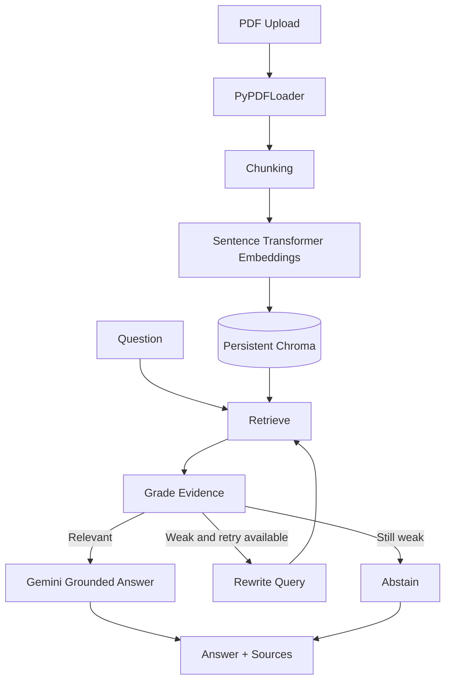

# DocuMind — Self-Correcting Enterprise RAG Agent

A portfolio-ready Retrieval-Augmented Generation (RAG) API using **FastAPI, LangChain, LangGraph, Gemini, Chroma, and local sentence-transformer embeddings**.

## What it does

- Ingests text-based PDF documents and splits them into overlapping chunks.
- Stores vectors in a persistent local Chroma collection.
- Retrieves relevant passages and grades their usefulness.
- Uses a LangGraph conditional workflow to rewrite the search query and retry once when evidence is weak.
- Answers from retrieved context with source markers, or abstains when evidence is insufficient.
- Exposes a small evaluation endpoint for expected-keyword coverage and expected-source hit rate.
- Keeps the Gemini API key in environment configuration.

> This is a one-day portfolio MVP, not a hardened production service. Before public deployment, add authentication, rate limiting, malware/content scanning, robust observability, user-scoped document access, and stricter upload/storage policies.

## Architecture



## Requirements

- Python 3.11 recommended (Python 3.10 may work; avoid Python 3.14 for this quick build).
- 8 GB RAM is sufficient for this lightweight CPU embedding model, though first model download and indexing take time.
- A Gemini API key. Usage is subject to Google's current model availability, quota, and billing settings.

## Setup (Windows PowerShell)

```powershell
# 1. From the project folder, create an isolated environment
conda create -n documind python=3.11 -y
conda activate documind

# 2. Install packages
python -m pip install --upgrade pip
pip install -r requirements.txt

# 3. Configure secrets
Copy-Item .env.example .env
notepad .env
# Replace GOOGLE_API_KEY with your actual key, save, and close.
```

Never upload `.env` to GitHub. `.gitignore` excludes it.

## Run the API

```powershell
uvicorn app.main:app --reload
```

Open:
- Interactive API docs: http://127.0.0.1:8000/docs
- Health check: http://127.0.0.1:8000/health
- Graph description: http://127.0.0.1:8000/graph

The first document upload downloads the embedding model; allow time for that.

## Test with the interactive docs

1. Open `/docs`.
2. Expand `POST /documents/upload`, choose a text-based PDF, and click **Execute**.
3. Expand `POST /query` and send:
   ```json
   {"question": "Summarize the key rules in the uploaded document."}
   ```
4. Review `answer`, `sources`, `steps`, `retries`, and `abstained`.
5. Try a question whose answer is not in the PDF. The agent should abstain when its evidence grader rejects the retrieved passages.

Only text-based PDFs are supported. OCR for scanned documents is intentionally out of scope for this MVP.

## Evaluate

Use `POST /evaluate` with a small dataset. Example:

```json
{
  "cases": [
    {
      "question": "What does the policy say about annual leave?",
      "expected_keywords": ["annual leave", "days"],
      "expected_source": "employee_handbook.pdf"
    },
    {
      "question": "What is the policy for living on Jupiter?",
      "expected_keywords": [],
      "expected_source": null
    }
  ]
}
```

Metrics:
- `keyword_case_pass_rate`: share of cases with at least one expected keyword found in the answer.
- `expected_source_hit_rate`: share of cases where a retrieved source filename matched the expected source.
- Individual `keyword_coverage`, graph steps, retries, and abstentions.

These are lightweight diagnostics, not full semantic evaluation. Report actual measured values; never invent benchmark results. For a stronger follow-up, add RAGAS or DeepEval and compare baseline RAG with the self-correcting workflow.

## Test the project

```powershell
pytest -q
```

The included tests cover basic API boot and file-type validation without requiring a Gemini call.

## Deploy

A simple option is a Docker-based host or Hugging Face Spaces configured for Docker. Set `GOOGLE_API_KEY` as a platform secret. The service uses local persistent Chroma storage and downloads an embedding model at startup/first indexing; ephemeral hosting can lose the index after restart unless you configure a persistent volume.

Before a public deployment:
- Add authentication and per-user access controls.
- Add request rate limits and API usage controls.
- Configure allowed CORS origins to the exact frontend domain.
- Use persistent storage for Chroma.
- Add PDF page-count limits, content scanning, and observability.
- Do not upload confidential company documents to a public demo.

## CV bullet (use only after testing)

**DocuMind — Self-Correcting Enterprise RAG Agent** | Python, FastAPI, LangChain, LangGraph, Gemini, Chroma
- Built a document-grounded Q&A API that ingests PDFs, retrieves semantic chunks, and returns evidence-backed answers with source metadata.
- Orchestrated a LangGraph workflow with relevance grading, conditional query rewriting, bounded retries, and abstention for unsupported questions.
- Added a lightweight evaluation endpoint to track expected-source hit rate, keyword coverage, retry behavior, and answer latency.

Repository URL: add after pushing to GitHub. Live demo: add only after successful deployment.
